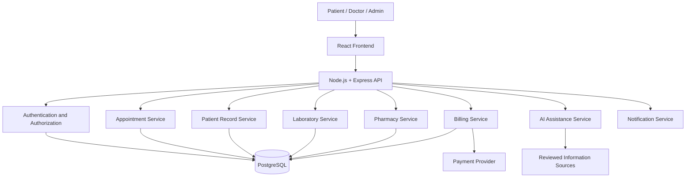

# 🏥 CareSphere 2.0 | Hospital & Clinic Management Platform

### Intelligent Healthcare. Connected Care. Better Experiences.

A modern digital healthcare platform designed to connect patients, doctors, laboratories, pharmacies, and hospital administrators through a unified experience.

<div align="center">

[🌐 Live Demo](https://hospital-management-sigma-snowy.vercel.app/) · [💻 GitHub](https://github.com/Mugunthandk) · [👨‍💻 LinkedIn](https://www.linkedin.com/in/mugunthandk/)


</div>

---

## 📖 Table of Contents

- [Overview](#-overview)
- [Vision and Objectives](#-vision-and-objectives)
- [Core Features](#-core-features)
- [AI-Powered Healthcare](#-ai-powered-healthcare)
- [Technology Stack](#-technology-stack)
- [System Architecture](#-system-architecture)
- [Project Structure](#-project-structure)
- [Getting Started](#-getting-started)
- [Environment Variables](#-environment-variables)
- [API Architecture](#-api-architecture)
- [Database Design](#-database-design)
- [Security and Privacy](#-security-and-privacy)
- [Testing](#-testing)
- [Deployment](#-deployment)
- [Development Roadmap](#-development-roadmap)
- [Contributing](#-contributing)
- [Developer](#-developer)
- [License](#-license)

---

## 🌟 Overview

CareSphere is a proposed evolution of a hospital and clinic website into a comprehensive digital healthcare management platform.

The platform aims to simplify healthcare access by connecting patients with doctors, medical departments, diagnostic laboratories, pharmacy services, and hospital administration.

The system combines appointment scheduling, patient-facing services, operational dashboards, and planned AI-assisted features within a responsive interface.

### 🎯 Project Objectives

- Improve access to healthcare information and services.
- Simplify doctor discovery and appointment scheduling.
- Provide patients with a unified portal for appointments and billing.
- Support doctors and administrators with organized workflows.
- Enable secure management of medical records and prescriptions.
- Introduce carefully controlled AI-assisted healthcare tools.
- Establish a scalable architecture for future integrations.

**Live Website:** https://hospital-management-sigma-snowy.vercel.app/

---

## ✨ Core Features

### 🏠 1. Healthcare Homepage

- Professional healthcare landing page.
- Featured doctors and departments.
- Hospital introduction and services.
- Appointment booking calls to action.
- Emergency contact information.
- Patient testimonials and FAQs.
- Contact information and location.
- Responsive navigation.

### 👨‍⚕️ 2. Doctor Discovery

- Doctor profiles and specialties.
- Qualifications and professional experience.
- Consultation information.
- Available appointment slots.
- Department-based filtering.
- Verified patient feedback, where available.
- Appointment booking entry points.

### 🩺 3. Medical Departments

Potential departments include:

- General Medicine
- Cardiology
- Neurology
- Orthopedics
- Pediatrics
- Dermatology
- ENT
- Dental Care
- Ophthalmology
- Oncology
- Pulmonology
- Urology
- Radiology
- Emergency Medicine

Actual clinical services should reflect the participating hospital's capabilities.

### 📅 4. Smart Appointment Management

- Doctor and department selection.
- Date and time slot selection.
- Patient information forms.
- Appointment requests and confirmation.
- Rescheduling and cancellation.
- Upcoming and past appointments.
- Appointment reminders.
- Doctor availability management.

A reliable booking backend should validate availability and prevent double bookings.

### 👤 5. Patient Portal

Planned features include:

- Secure account access.
- Profile and contact management.
- Appointment history.
- Medical record access.
- Prescriptions and reports.
- Bills and payment history.
- Follow-up appointment information.
- Notification preferences.

Access to sensitive records must be restricted to authorized users.

### 🧪 6. Laboratory Services

- Diagnostic test catalog.
- Health package listings.
- Test preparation instructions.
- Laboratory booking requests.
- Home sample collection requests.
- Report availability notifications.
- Secure report access.

Laboratory reports should only be displayed after issuance and verification by the authorized laboratory workflow.

### 💊 7. Pharmacy Services

- Medicine catalog.
- Prescription upload workflow.
- Medicine availability.
- Order requests and status.
- Delivery information.
- Inventory management.
- Pharmacist review for prescription-restricted medicines.

Prescription validation and medicine dispensing must follow applicable laws and professional requirements.

### 🚑 8. Emergency Services

- Emergency contact information.
- Ambulance contact and request workflows.
- Hospital location and directions.
- Verified blood bank information, where available.
- Emergency department information.
- Clear instructions to contact local emergency services.

Emergency requests must not depend solely on an AI chatbot or an unmonitored web form.

### 💳 9. Billing and Payments

Planned capabilities include:

- Consultation fee information.
- Bill generation.
- Payment gateway integration.
- Payment status verification.
- Digital receipts.
- Billing history.
- Refund processing workflows.
- Administrative payment reconciliation.

Payment status must be verified by the backend and payment provider.

### 🔐 10. Authentication and Access Control

- Patient registration and login.
- Secure session management.
- Password recovery.
- Role-based permissions.
- Doctor and administrator accounts.
- Protected patient records.
- Session expiration and logout.
- Audit logging for sensitive actions.

### 📊 11. Hospital Administration Dashboard

Planned features:

- Appointment overview.
- Doctor and department management.
- Patient registration management.
- Scheduling and availability.
- Billing reports.
- Pharmacy inventory.
- Laboratory workflow management.
- Operational analytics.
- Authorized user and permission management.

### 📱 12. Modern User Experience

- Responsive desktop, tablet, and mobile layouts.
- Accessible forms and navigation.
- Clear status indicators.
- Loading skeletons and error states.
- Consistent typography and spacing.
- Optimized images and assets.
- Keyboard navigation.
- Performance-conscious page rendering.

---

## 🤖 AI-Powered Healthcare

AI can assist with information discovery and administrative workflows when implemented with appropriate safeguards.

### AI Health Information Assistant

Potential capabilities:

- Answer general healthcare questions using reviewed informational content.
- Explain appointment procedures and hospital services.
- Help users locate relevant departments.
- Summarize approved educational materials.
- Direct users to appropriate professional care when necessary.

### AI Appointment Assistant

- Help users find doctors by specialty.
- Suggest available appointment slots from the booking system.
- Explain appointment requirements.
- Assist with scheduling and reminders.

### AI-Assisted Medical Document Summaries

A future clinician-supervised feature could summarize uploaded reports or medical documents for review by authorized professionals.

### Important Clinical Safeguards

- Do not present AI output as a confirmed diagnosis.
- Do not prescribe medicines or change treatments automatically.
- Use verified clinical sources for medical information.
- Require qualified clinical review for clinical decision-support workflows.
- Protect patient data and obtain appropriate consent.
- Do not use real patient records as demo data.
- Direct emergencies to appropriate human emergency services.

> **Implementation status:** AI capabilities described here are proposed extensions unless they have already been implemented and tested.

---

## 🛠️ Technology Stack

### Frontend

| Technology | Purpose |
|---|---|
| React | User interface |
| TypeScript | Type safety |
| Vite | Development and build tooling |
| Tailwind CSS | Responsive styling |
| Lucide React | Icons |
| React Router | Client-side navigation |
| Framer Motion | Optional animations |
| Vercel | Frontend hosting |

### Proposed Backend and Integrations

| Technology | Purpose |
|---|---|
| Node.js | Backend runtime |
| Express.js | REST API |
| PostgreSQL | Structured healthcare data |
| Prisma | Database access and migrations |
| Secure sessions or JWT | Authentication |
| Firebase Authentication | Alternative authentication provider |
| Private object storage | Document storage |
| Razorpay | Payment integration |
| Resend | Transactional notifications |
| Vitest | Unit testing |
| Playwright | End-to-end testing |

Backend and integration choices are proposed. Update this section to reflect the technologies actually present in the repository.

---

## 🏗️ System Architecture

The following diagram illustrates the proposed full-stack architecture.



### Architecture Principles

- Separate frontend presentation from backend business logic.
- Enforce permissions at API and data-access layers.
- Use database transactions for sensitive multi-step operations.
- Maintain appointment consistency and prevent double booking.
- Store sensitive records using appropriate access controls.
- Keep external API credentials on the server.
- Maintain auditable histories for critical operations.

---

## 📂 Project Structure

### Frontend

```text
hospital-management/
├── public/
│   ├── images/
│   └── favicon.svg
├── src/
│   ├── assets/
│   ├── components/
│   │   ├── common/
│   │   ├── layout/
│   │   ├── doctors/
│   │   ├── appointments/
│   │   └── dashboard/
│   ├── pages/
│   ├── layouts/
│   ├── hooks/
│   ├── services/
│   ├── context/
│   ├── types/
│   ├── utils/
│   ├── styles/
│   ├── App.tsx
│   └── main.tsx
├── tests/
├── package.json
├── vite.config.ts
├── tsconfig.json
└── README.md
```

### Proposed Backend

```text
server/
├── src/
│   ├── config/
│   ├── middleware/
│   ├── controllers/
│   ├── routes/
│   ├── models/
│   ├── services/
│   ├── validators/
│   ├── audit/
│   ├── utils/
│   ├── app.ts
│   └── server.ts
├── tests/
├── package.json
└── .env.example
```

This is a suggested structure. Adapt it to the actual repository before documenting it as the current layout.

---

## ⚙️ Getting Started

### Prerequisites

- Node.js compatible with the project's Vite version.
- npm.
- Git.
- Visual Studio Code or another code editor.

A database and third-party accounts are only required when the corresponding backend integrations are implemented.

### 1. Clone the Repository

```bash
git clone https://github.com/Mugunthandk/hospital-management.git
cd hospital-management
```

Replace the example repository URL with the actual GitHub URL if your repository uses another name.

### 2. Install Dependencies

```bash
npm install
```

### 3. Start the Development Server

```bash
npm run dev
```

### 4. Open the Application

Vite typically uses:

```text
http://localhost:5173
```

Use the local URL displayed in your terminal.

### 5. Build for Production

```bash
npm run build
```

### 6. Preview the Production Build

```bash
npm run preview
```

Confirm the available commands in `package.json`.

---

## 🔐 Environment Variables

For the proposed full-stack implementation, create a server-side `.env` file.

Example `.env.example`:

```env
NODE_ENV=development
PORT=5000

DATABASE_URL=your_database_connection_string

SESSION_SECRET=your_long_random_secret

PAYMENT_PROVIDER_KEY=your_test_key
PAYMENT_PROVIDER_SECRET=your_test_secret

EMAIL_API_KEY=your_email_provider_api_key

CLIENT_URL=http://localhost:5173
```

Add only the variables required by the services you implement.

### Security Requirements

- Never commit `.env` files.
- Keep secrets on the backend.
- Use separate development and production credentials.
- Restrict access to sensitive records.
- Configure HTTPS in production.
- Avoid exposing patient information in URLs, logs, or analytics.
- Use appropriate backup and recovery procedures.

---

## 🔌 Proposed API Architecture

| Method | Endpoint | Purpose |
|---|---|---|
| GET | `/api/doctors` | List doctors |
| GET | `/api/departments` | List departments |
| GET | `/api/appointments/availability` | Check appointment availability |
| POST | `/api/appointments` | Request an appointment |
| GET | `/api/appointments` | Retrieve authorized appointments |
| GET | `/api/patients/me` | Retrieve the current patient profile |
| GET | `/api/patients/me/records` | Retrieve authorized patient records |
| GET | `/api/laboratory/tests` | Browse diagnostic tests |
| GET | `/api/pharmacy/products` | Browse pharmacy products |
| POST | `/api/payments/verify` | Verify a payment |
| POST | `/api/assistant/questions` | Request general informational assistance |
| GET | `/api/admin/analytics` | Retrieve authorized administrative analytics |

These are proposed endpoints, not claims that the current application already provides them.

All patient-specific and administrative endpoints must verify the user's identity and permissions on the server.

---

## 🗄️ Database Design

The proposed PostgreSQL schema can include:

| Entity | Purpose |
|---|---|
| Users | Authentication identity and role |
| Patients | Patient profile and contact information |
| Doctors | Professional profile and department |
| Departments | Medical service categories |
| Schedules | Doctor availability |
| Appointments | Appointment status and scheduling |
| Medical Records | Authorized clinical documents |
| Prescriptions | Prescribing and review information |
| Laboratory Orders | Requested diagnostic services |
| Laboratory Reports | Issued reports and access permissions |
| Pharmacy Products | Medicine catalog |
| Pharmacy Orders | Pharmacy order workflow |
| Bills | Charges and billing information |
| Payments | Payment references and verified statuses |
| Audit Logs | Security-relevant actions |

### Data Integrity

- Use transactions for appointment and billing workflows.
- Prevent conflicting doctor bookings.
- Apply strict authorization to patient records.
- Record important changes to clinical and administrative data.
- Maintain appropriate retention and deletion policies.
- Keep payment details limited to necessary provider references.
- Use synthetic data for demonstrations and development.

---

## 🛡️ Security, Privacy, and Healthcare Compliance

Healthcare applications require stronger privacy protections than ordinary informational websites.

Recommended safeguards include:

- Role-based access control.
- Secure authentication and password hashing.
- Encryption in transit and appropriate encryption at rest.
- Audit logging for access to sensitive records.
- Request validation and rate limiting.
- Restricted cross-origin access.
- Secure file upload and download controls.
- Regular dependency and security reviews.
- Backup and disaster recovery procedures.
- Appropriate consent, retention, and data handling policies.

Applicable healthcare privacy, medical record, and data protection requirements depend on the operating jurisdiction and actual deployment.

A portfolio demonstration should use synthetic patient data and must not be represented as a certified clinical system without the relevant verification and approvals.

---

## 🧪 Testing

### Build Verification

```bash
npm run build
```

### Unit Tests

```bash
npm run test
```

### End-to-End Tests

```bash
npx playwright test
```

These commands require the corresponding scripts and testing dependencies to be configured.

### Essential Test Scenarios

- Doctor search and department filtering.
- Appointment availability validation.
- Prevention of duplicate bookings.
- Authentication and access permissions.
- Unauthorized access to patient records.
- Payment success and failure handling.
- Appointment cancellation and rescheduling.
- Laboratory report access restrictions.
- Responsive layouts and accessibility.
- API errors and external service failures.

---

## 🚀 Deployment

### Frontend Deployment Using Vercel

1. Push the project to GitHub.
2. Import the repository into Vercel.
3. Configure the correct project root.
4. Set the build command to `npm run build`.
5. Configure the output directory, usually `dist`.
6. Add any required frontend environment variables.
7. Deploy and verify the production website.

**Live Website:** https://hospital-management-sigma-snowy.vercel.app/

### Backend Deployment Using Render

When the backend is implemented:

1. Create a backend web service.
2. Configure the build and start commands.
3. Add the required server environment variables.
4. Configure secure database connectivity.
5. Set trusted frontend origins.
6. Test authentication, authorization, and API behavior.
7. Verify backups, logs, and recovery procedures.

---

## 🗺️ Development Roadmap

### Phase 1: Patient-Facing Website

- [x] Initial hospital website foundation.
- [x] Responsive frontend direction.
- [ ] Complete doctor discovery.
- [ ] Department detail pages.
- [ ] Appointment form validation.

### Phase 2: Backend and Authentication

- [ ] Express REST API.
- [ ] PostgreSQL integration.
- [ ] Secure patient authentication.
- [ ] Doctor and department management.
- [ ] Appointment scheduling backend.

### Phase 3: Hospital Workflows

- [ ] Patient dashboard.
- [ ] Medical record access controls.
- [ ] Laboratory workflow.
- [ ] Pharmacy inventory.
- [ ] Billing and payment verification.

### Phase 4: AI Assistance

- [ ] General healthcare information assistant.
- [ ] AI-assisted appointment discovery.
- [ ] Clinician-reviewed document summaries.
- [ ] Approved medical knowledge retrieval.
- [ ] Safety and quality evaluations.

### Phase 5: Production Readiness

- [ ] Automated test coverage.
- [ ] Security and privacy review.
- [ ] Accessibility testing.
- [ ] Performance optimization.
- [ ] Backup and recovery verification.
- [ ] Deployment monitoring.

Mark each feature complete only after implementation and testing.

---

## 🤝 Contributing

Contributions, bug reports, and feature suggestions are welcome.

1. Fork the repository.
2. Create a feature branch.

   ```bash
   git checkout -b feature/your-feature
   ```

3. Implement and test your changes.
4. Commit your work.

   ```bash
   git commit -m "docs: update documentation"
   ```

5. Push the branch.

   ```bash
   git push origin feature/your-feature
   ```

6. Open a pull request with a description of the changes.

---

## 👨‍💻 Developer

### Mugunthan DK

**Full Stack Developer | AI/ML Enthusiast**

B.Tech Information Technology, VSB Engineering College

- **Live Project:** https://hospital-management-sigma-snowy.vercel.app/
- **GitHub:** https://github.com/Mugunthandk
- **LinkedIn:** https://www.linkedin.com/in/mugunthandk/
- **Portfolio:** https://mugunthandk-portfolio-vvuy.vercel.app/

Interested in developing modern web applications, AI-assisted products, and reliable software solutions.

---

## 📄 License

The existing README mentions the MIT License. Confirm that an MIT `LICENSE` file exists in the repository before retaining that claim.

---

<div align="center">

### 🏥 CareSphere 2.0

**Connected Care. Smarter Workflows. Better Experiences.**

Built with ❤️ by **Mugunthan DK**

[Visit Live Website](https://hospital-management-sigma-snowy.vercel.app/)

</div>
